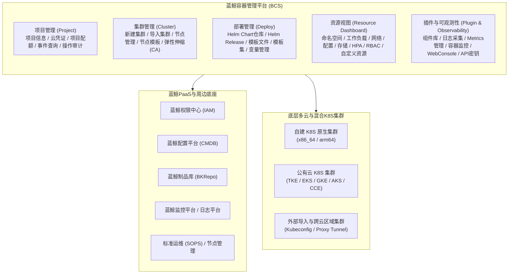

# 产品架构与功能全景

## 平台功能架构

蓝鲸容器管理平台（BCS）围绕**项目（Project）**组织资源，提供五大核心功能模块与配套辅助工具，覆盖容器集群与应用的完整生命周期：

---

## 核心功能模块一览

### 1. 资源视图（Kubernetes 对象可视化管理）

为用户提供单集群下各类 Kubernetes 原生资源及 BCS 扩展 CRD 的表单化与 YAML 化全生命周期管理：

- **命名空间（Namespaces）**：创建/删除命名空间、设置 CPU/内存资源配额（ResourceQuota）、配置命名空间标签、注解与变量值。
- **工作负载（Workloads）**：
  - `Deployments`（无状态应用）
  - `StatefulSets`（有状态应用）
  - `DaemonSets`（守护进程集）
  - `Jobs` 与 `CronJobs`（批处理与定时任务）
  - `Pods`（容器实例列表、状态详情、容器标准输出日志、事件查看、容器在线终端、Pod 重新调度）
- **网络（Networks）**：
  - `Services`（ClusterIP、NodePort、LoadBalancer、Headless Service）
  - `Ingresses`（七层/四层路由规则、TLS 证书配置）
  - `Endpoints`（服务端点状态查看）
- **配置（Configurations）**：
  - `ConfigMaps`（非敏感配置文件与环境变量）
  - `Secrets`（敏感凭据、TLS 证书、镜像拉取密钥 `kubernetes.io/dockercfg`）
  - `BscpConfigs`（对接蓝鲸服务配置中心）
- **存储（Storages）**：
  - `PersistentVolumes (PV)`（持久卷查看与管理）
  - `PersistentVolumeClaims (PVC)`（持久卷声明创建与绑定）
  - `StorageClasses`（动态存储类查看）
- **RBAC 权限控制**：`ServiceAccounts` 管理。
- **弹性伸缩（HPA）**：水平 Pod 自动扩缩容策略管理。
- **自定义资源（CRD & Custom Objects）**：
  - 游戏扩展工作负载：`GameDeployments`、`GameStatefulSets`、`HookTemplates`。
  - 网络扩展：`BcsIngressController` 相关 CRD（`Ingress`、`PortPool`、`PortBinding`、`Listener`）。
  - 集群内任意其他自定义 CRD 实例（CustomObjects）的查看与编辑。

### 2. 集群管理（Cluster Management）

- **新建集群**：
  - **K8S 原生集群**：基于 CMDB 业务主机，在私有化环境自动化搭建高可用 K8S 集群。
  - **公有云集群**：支持腾讯云 TKE、亚马逊云 EKS、谷歌云 GKE、微软云 AKS 等公有云集群创建。
  - **虚拟集群（vCluster）与联邦集群（Clusternet）**：支持共享集群虚拟化与多集群联邦管理。
- **导入外部集群**：
  - **通过云凭证导入**：支持腾讯云、谷歌云、亚马逊云、微软云、华为云，保留云资源（节点、节点池、负载均衡）管控能力。
  - **通过 Kubeconfig 导入**：兼容任意标准 K8S 集群，快速纳管集群内部资源。
- **集群运维**：
  - **节点管理**：添加节点（已有服务器或节点池扩容）、停止调度（Cordon）、恢复调度（Uncordon）、Pod 驱逐（Drain）、批量设置节点标签（Labels）与污点（Taints）、删除/重试失败节点。
  - **节点模板**：预设节点初始化参数、标签、污点及前置/后置脚本。
  - **集群弹性伸缩（Cluster Autoscaler）**：管理云节点池（NodePool），根据待调度 Pod 资源请求自动扩缩容计算节点。

### 3. 部署管理（Deployment Management）

- **Helm 管理**：
  - **Chart 仓库**：内置项目私有仓库（读写）与 `public-charts` 公共仓库（只读共享）。
  - **Helm Release**：可视化表单与 `values.yaml` 双向同步配置、渲染预览、一键安装、版本对比升级、一键回滚与卸载。
- **模板文件（Template File）与模板集**：
  - 支持按模板空间（文件夹）组织多份 YAML 模板文件，进行多版本管理、Diff 对比、变量渲染预览与跨命名空间批量部署。
- **变量管理（Variables）**：
  - 支持定义全局变量、集群变量和命名空间变量，在 Helm Chart 和模板文件中灵活引用，实现“一套模板、多环境差异化部署”。

### 4. 项目管理（Project Management）

- **项目信息与配额**：管理项目基本信息、绑定 CMDB 业务、查看项目级资源配额使用率。
- **云凭证管理**：集中托管腾讯云、谷歌云、AWS、Azure、华为云等访问凭证。
- **事件查询（Event Query）**：持久化采集并检索集群 K8S 事件（Normal / Warning），避免原生 K8S Event 过期丢失。
- **操作记录（Audit Logs）**：审计项目下所有资源的创建、更新、删除等操作轨迹。

### 5. 插件管理与辅助功能

- **组件库（Cluster Tools）**：一键安装与升级集群核心插件，如 `bcs-gamedeployment-operator`、`bcs-gamestatefulset-operator`、`bcs-hook-operator`、`bcs-ingress-controller`、`bcs-general-pod-autoscaler`、`bkmonitor-operator`、`bcs-k8s-watch`、DB 授权组件、北极星（Polaris）服务网格组件等。
- **日志采集（Log Collector）**：配置容器标准输出（Stdout）与容器内文件路径日志采集规则，自动同步至蓝鲸日志平台。
- **Metrics 管理与容器监控**：配置 ServiceMonitor 指标抓取，无缝跳转蓝鲸监控平台查看集群、节点、工作负载和 Pod 性能大盘。
- **WebConsole**：浏览器内一键打开免配置的 `kubectl` 终端或直接进入指定容器内部 Shell。
- **API 密钥与 Kubeconfig**：生成个人或长期访问凭证，通过 BCS 网关安全调用集群 K8S API。
