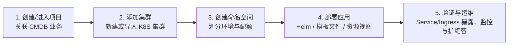

# 快速入门指南

本指南带您从零开始，完成在蓝鲸容器管理平台（BCS）中**创建项目 → 准备集群 → 创建命名空间 → 部署应用 → 访问与运维应用**的完整标准流程。

---

## 整体流程概览



---

## 第一步：创建或进入项目

1. 登录蓝鲸容器管理平台（BCS）控制台。
2. **获取项目**：
   - **新建项目**：点击顶部项目选择器中的【项目管理】→【创建项目】，填写**项目名称**、**项目英文名**（2~32 位小写字母、数字、中划线，以小写字母开头）及项目说明。
   - **加入已有项目**：若团队已创建项目，直接点击目标项目名称，按弹窗提示前往蓝鲸权限中心申请该项目的**项目查看**权限。
3. **关联 CMDB 业务并启用容器服务**：
   - 首次进入新项目时，选择并绑定当前用户在蓝鲸配置平台（CMDB）中拥有**业务运维**角色的业务。
   - 绑定后，项目即可使用该 CMDB 业务下的主机资源创建集群或添加节点。

---

## 第二步：添加 Kubernetes 集群

进入顶部导航栏【集群管理】，点击【添加集群】，根据您的实际环境选择以下任一方式：

### 方式 A：新建 K8S 原生集群（私有化环境）
- **控制面要求**：从 CMDB 业务主机中选择奇数台 Master 节点（生产高可用要求 **3 台或 5 台**，测试环境支持 1 台），推荐配置至少 **4 核 8G**，系统为 CentOS 7.4+（内核 `3.10.0-693` 及以上），且节点已安装蓝鲸 GSE Agent 且状态正常。
- **工作节点要求**：可同时添加 Worker 节点或建群后再添加，需确保节点内核 NAT 模块已加载。

### 方式 B：新建公有云集群（如腾讯云 TKE）
- 提前在【项目管理】→【云凭证】中配置腾讯云 SecretID / SecretKey。
- 在【新建集群】→【公有云集群】中选择地域、VPC、网络插件（GlobalRouter 或 VPC-CNI）、控制面模式（托管集群或独立集群）及节点规格，提交创建。

### 方式 C：导入外部已有集群
- 支持通过**云凭证**导入已有公有云集群（推荐，支持节点与节点池管控），或直接上传/粘贴 **Kubeconfig** 导入任意标准 K8S 集群。

---

## 第三步：创建命名空间

应用实例均部署在特定集群的命名空间（Namespace）下：

1. 进入顶部导航栏【资源视图】→ 左侧菜单【命名空间】（或在【集群管理】的命名空间页）。
2. 选择目标集群，点击【新建】按钮。
3. 输入命名空间名称（如 `demo-app`，仅允许小写字母、数字和连字符 `-`），按需配置 CPU/内存配额与标签，点击【确定】。

> **注意**：命名空间创建后名称不可修改；删除命名空间将清理其下所有资源，请谨慎操作。

---

## 第四步：部署容器应用（以 Nginx 为例）

BCS 支持三种主流部署方式，您可以任选其一：

### 方式 1：通过【资源视图】直接创建（最快体验）

1. 进入【资源视图】→【工作负载】→【Deployments】，左上角选择目标集群与命名空间 `demo-app`。
2. 点击【创建】（支持表单创建或 YAML 创建），使用以下 YAML 创建 `nginx-demo`：

```yaml
apiVersion: apps/v1
kind: Deployment
metadata:
  name: nginx-demo
  namespace: demo-app
  labels:
    app: nginx-demo
spec:
  replicas: 2
  selector:
    matchLabels:
      app: nginx-demo
  template:
    metadata:
      labels:
        app: nginx-demo
    spec:
      containers:
        - name: nginx
          image: nginx:1.24.0
          imagePullPolicy: IfNotPresent
          ports:
            - containerPort: 80
          resources:
            requests:
              cpu: 100m
              memory: 128Mi
            limits:
              cpu: 500m
              memory: 512Mi
```

3. 接着进入【资源视图】→【网络】→【Services】，创建关联的 Service 暴露服务：

```yaml
apiVersion: v1
kind: Service
metadata:
  name: nginx-demo-svc
  namespace: demo-app
spec:
  type: NodePort
  selector:
    app: nginx-demo
  ports:
    - name: http
      protocol: TCP
      port: 80
      targetPort: 80
```

### 方式 2：通过【Helm】部署应用（推荐生产使用）

1. 进入顶部导航栏【部署管理】→【Chart 仓库】。
2. 可选择 `public-charts` 公共仓库中的已有 Chart，或将业务自定义 Chart 推送至项目专属仓库。
3. 点击目标 Chart 右侧的【部署】，选择目标集群、命名空间 `demo-app`，填写 Release 名称并修改 `values.yaml` 参数。
4. 点击【预览】核对渲染后的 K8S 资源无误后，点击【部署】完成发布。

### 方式 3：通过【模板文件】部署应用

1. 进入【部署管理】→【模板文件】，新建模板空间与模板文件，编写包含 Deployment、Service 等资源的 YAML（支持使用 `{{ .VARIABLE }}` 引用平台变量）。
2. 保存版本后点击【部署】，选择目标集群与命名空间一键下发。

---

## 第五步：验证与日常运维

1. **查看运行状态**：
   - 在【资源视图】→【工作负载】→【Deployments】中点击 `nginx-demo`，查看 Pod 列表是否全部为 `Running` 且 `Ready (1/1)`。
2. **查看容器日志与进入终端**：
   - 在 Pod 详情页可实时查看容器标准输出日志（Logs）、K8S 事件（Events），或点击【WebConsole】直接进入容器终端调试。
3. **访问服务**：
   - 在【网络】→【Services】中查看 `nginx-demo-svc` 分配的 `NodePort` 端口，通过 `http://<任意集群节点IP>:<NodePort>` 访问服务，或配置 `Ingress` 通过域名访问。
4. **日常变更操作**：
   - **扩缩容**：在 Deployment 列表或详情页调整副本数（Replicas），或配置 HPA 自动扩缩容。
   - **滚动升级与回滚**：修改容器镜像版本触发滚动升级，若是通过 Helm Release 部署，可在【Release 列表】中随时对比版本并一键回滚。
