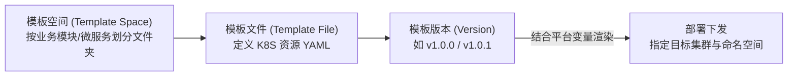

# 模板文件（Template File）与变量管理指南

除了使用 Helm Chart 管理应用外，蓝鲸容器管理平台（BCS）在【部署管理】模块中还提供了轻量、直观的**模板文件（Template File / 模板集）**与**变量管理（Variables）**能力，帮助用户直接维护多版本 Kubernetes YAML 清单并实现跨集群、跨命名空间的参数化批量部署。

---

## 一、模板文件管理（Template File）

模板文件功能允许用户按**模板空间（文件夹）**组织多个 Kubernetes 资源配置文件（支持在一个 YAML 文件中通过 `---` 分隔包含 Deployment、Service、ConfigMap、Ingress 等多个资源），并提供版本控制、YAML 对比与可视化表单切换。

### 1. 核心概念层级

### 2. 创建与部署模板文件步骤

1. **创建模板空间**：
   - 进入顶部导航栏【部署管理】→【模板文件】。
   - 在左侧树形目录点击【新建文件夹（模板空间）】，按业务系统或服务模块命名。
2. **新建模板文件与版本**：
   - 在目标模板空间下点击【新建模板文件】，填写文件名称、描述及初始版本号（如 `1.0.0`）。
   - 支持 **YAML 模式**（直接编写标准 K8S YAML，支持语法高亮与校验）与 **表单模式** 互转。
   - 若需实现不同环境参数差异化，可在 YAML 中使用 `{{ .VARIABLE_KEY }}` 语法引用 BCS 变量。
3. **版本管理与 Diff 对比**：
   - 后续修改模板时，可点击【新增版本】保存新版本号，并随时使用 **Diff 对比** 功能查看任意两个历史版本之间的配置差异。
4. **预览与部署（支持单文件或整空间批量部署）**：
   - 点击模板文件的【部署】（或对整个模板空间点击【批量部署】）。
   - 选择**模板版本**、**目标集群**和**目标命名空间**。
   - 若模板中引用了变量，页面会自动列出变量表单供核对或覆盖取值。
   - 点击【预览】检查渲染后的最终 YAML 内容，确认无误后点击【部署】一键应用到集群。

---

## 二、变量管理（Variables）

通过【部署管理】→【变量管理】，用户可以在项目内集中定义自定义变量，供**模板文件 / 模板集**引用，避免为每个集群或每个命名空间重复复制维护多套仅有少量参数差异的 YAML。

### 1. 变量的作用范围（Scope）

BCS 支持三种作用范围的变量：

| 变量作用范围 | 取值粒度 | 典型使用场景 |
| :--- | :--- | :--- |
| **全局变量** | 整个项目下所有集群、所有命名空间共用同一个值 | 公共镜像仓库地址、全局公共域名、统一日志级别 |
| **集群变量** | 按**集群**分别设置不同的变量值 | 不同集群对应的 Redis/MySQL 内网连接地址、集群专属 CLB ID |
| **命名空间变量** | 按**集群 + 命名空间**分别设置不同的变量值 | `dev` / `test` / `prod` 不同命名空间的副本数（`REPLICAS`）、资源配额、环境标识 |

### 2. 创建与使用变量流程

1. **定义变量**：
   - 进入【部署管理】→【变量管理】→ 点击【新增变量】。
   - 填写**变量名称**、**变量 Key**（如 `APP_REPLICAS`、`REDIS_HOST`）、**作用范围**（全局 / 集群 / 命名空间）及**默认值**。
2. **为不同集群或命名空间赋特定值**：
   - 在变量列表中点击目标变量的【设置值】，或前往【资源视图】→【命名空间】点击【设置变量值】，为各环境填写具体取值。
3. **在模板文件中引用**：
   - 在模板文件 YAML 中使用 `{{ .APP_REPLICAS }}` 或 `{{ .REDIS_HOST }}` 引用该变量。部署时，BCS 会根据所选的目标集群和命名空间自动代入对应的值。
