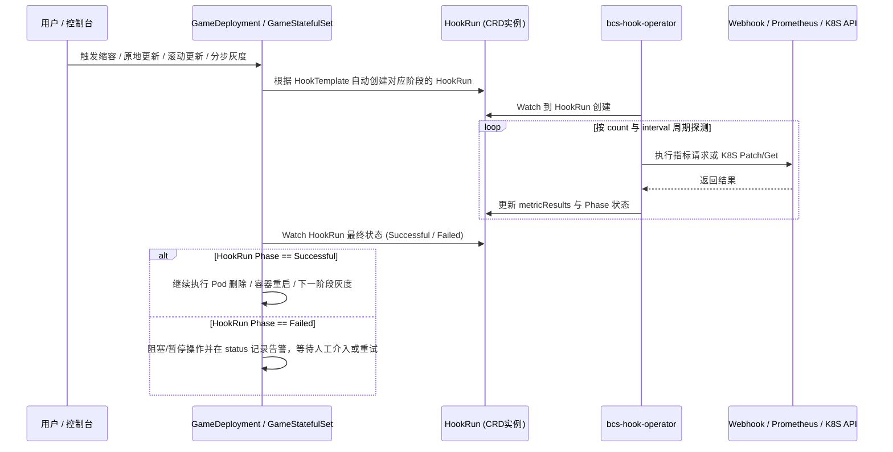

# 发布钩子（bcs-hook-operator）与智能分步灰度（Canary）指南

在游戏服及复杂有状态/无状态微服务的发布、更新与缩容过程中，往往存在强外部依赖（例如：缩容或重启前需等待当前游戏房间对局结束、需先完成内存数据持久化搬迁、需先将 CLB 权重调为 0 摘除流量；灰度发布下一步前需检查 Prometheus 错误率指标是否正常）。

Kubernetes 原生仅提供容器级 `preStop` / `postStart`，无法满足跨系统指标校验与发布流程编排需求。为此，BCS 提供了通用钩子控制器 **`bcs-hook-operator`**（包含 `HookTemplate` 与 `HookRun` 两个 CRD），并与 `GameDeployment` / `GameStatefulSet` 深度联动。

---

## 一、核心工作机制与挂载时机



### 支持挂载 Hook 的四大生命周期阶段

在 `GameDeployment` 或 `GameStatefulSet` 的 `spec` 中，可在以下四个位置引用 `HookTemplate`：

| 挂载字段路径 | 触发时机 | 典型业务场景 |
| :--- | :--- | :--- |
| **`spec.preDeleteUpdateStrategy.hook`** | 控制器触发**缩容删除 Pod** 或 **`RollingUpdate` 销毁旧 Pod** 之前（注：手工直接 `kubectl delete pod` 不会触发） | 检查游戏服房间对局是否已全部结束、执行优雅数据落盘 |
| **`spec.preInplaceUpdateStrategy.hook`** | 控制器执行 **`InplaceUpdate` 原地重启容器** 之前 | 调用接口通知进程准备重启，或通过 K8S Hook 将 Pod 的 CLB 权重置为 `0` 摘流 |
| **`spec.postInplaceUpdateStrategy.hook`** | 容器完成 **`InplaceUpdate` 原地重启** 之后 | 校验新容器业务健康度，或通过 K8S Hook 将 Pod 的 CLB 权重恢复为正常值 |
| **`spec.updateStrategy.canary.steps[].hook`** | **分步骤灰度发布（Canary）** 到达指定步骤时 | 查询 Prometheus 监控指标或外部质量接口，决定是否自动继续下一批灰度 |

---

## 二、`HookTemplate` 三种 Provider 类型详解

`HookTemplate` 用于定义钩子检测逻辑，一个模板可包含多个 `metrics` 检测项，通过 `spec.policy` 控制执行顺序（`Parallel` 并行执行，默认；`Ordered` 按序串行执行）。目前支持 **Web（HTTP Webhook）**、**Prometheus** 和 **Kubernetes** 三种 Provider：

### 1. Web（Webhook）类型 Provider

向指定 HTTP URL 发送 `GET` 请求，通过 `jsonPath` 提取返回 JSON 中的字段，并与 `successCondition` / `failureCondition` 表达式比对。

- **内置自动注入变量（`args`）**：
  在 `preDelete` / `preInplace` / `postInplace` 阶段，Operator 创建 `HookRun` 时会自动注入与当前目标 Pod 绑定的变量（注意：在 URL 模板中引用时，**双花括号内部两侧必须保留空格**，如 `{{ args.PodIP }}`）：
  - `{{ args.PodIP }}`：目标 Pod 的 IP 地址
  - `{{ args.PodName }}`：目标 Pod 的名称
  - `{{ args.PodNamespace }}`：目标 Pod 所在命名空间
  - `{{ args.PodContainer[0] }}`：按容器定义顺序注入的容器名称
  - `{{ args.ModifiedContainer[0] }}`：`preInplace` 阶段触发镜像变更的容器名称
  > 注：`canary.steps[].hook` 面向整个应用而非单个 Pod，因此不支持上述单 Pod 预置变量，但可使用自定义 `args`。

```yaml
apiVersion: tkex.tencent.com/v1alpha1
kind: HookTemplate
metadata:
  name: game-predelete-web-hook
  namespace: default
  labels:
    io.tencent.bcs.dev/deletion-allow: Always
spec:
  policy: Ordered
  args:
    - name: token
      value: "custom-secret-token"
  metrics:
    - name: check-online-players
      # 最多探测 10 次，每次间隔 5 秒，超时 60 秒；只要成功 1 次即判定通过
      count: 10
      interval: 5s
      successfulLimit: 1
      successCondition: "asInt(result) == 0"
      provider:
        web:
          url: "http://{{ args.PodIP }}:8080/hook/online_count?pod={{ args.PodName }}&token={{ args.token }}"
          jsonPath: "{$.online_players}"
          timeoutSeconds: 60
```

### 2. Prometheus 类型 Provider

定期向集群内或外部 Prometheus 发送 PromQL 查询，根据返回的指标值决定是否通过：

- **返回值类型与表达式编写规范**：
  - 若查询结果为字符串：使用 `asInt(result) == 0`。
  - 若查询结果为 `vector`（数组，且元素为 float64）：使用下标取值如 `successCondition: "result[0] == 0"` 或包含判断 `"0 in result"`（此时切勿使用 `asInt`）。
  - 若查询结果为 `scalar`（标量数值，如使用了 `scalar(...)` 函数）：直接比较 `successCondition: "result == 0"`。

```yaml
apiVersion: tkex.tencent.com/v1alpha1
kind: HookTemplate
metadata:
  name: canary-prometheus-hook
  namespace: default
spec:
  metrics:
    - name: check-error-rate
      count: 5
      interval: 10s
      consecutiveErrorLimit: 3
      successCondition: "result[0] == 0"
      provider:
        prometheus:
          address: http://po-prometheus-operator-prometheus.thanos.svc.cluster.local:9090
          query: sum(rate(http_requests_failed_total{app="gameserver"}[1m]))
```

### 3. Kubernetes 类型 Provider（常用于原地更新平滑切流）

支持对目标 Pod（或在 `args` 中指定 GVK 的 `GameDeployment` / `GameStatefulSet`）的 `metadata.annotations` 字段执行 **`patch`**（写入注解值）和 **`get`**（轮询校验注解值是否达到预期值）。

**典型实战场景：配合 `bcs-ingress-controller` 在原地更新前后无损切断与恢复 CLB 流量**：

#### （1）原地更新前（`preInplaceUpdateStrategy`）：将 CLB 权重置为 0 并等待生效

```yaml
apiVersion: tkex.tencent.com/v1alpha1
kind: HookTemplate
metadata:
  name: clb-drain-before-inplace
  namespace: default
spec:
  policy: Ordered
  metrics:
    - name: set-clb-weight-zero
      provider:
        kubernetes:
          function: patch
          fields:
            - path: metadata.annotations.networkextension.bkbcs.tencent.com/clb-weight
              value: "0"
            - path: metadata.annotations.networkextension.bkbcs.tencent.com/clb-weight-ready
              value: "false"
      successfulLimit: 1
      interval: 5s
    - name: wait-clb-weight-ready
      provider:
        kubernetes:
          function: get
          fields:
            - path: metadata.annotations.networkextension.bkbcs.tencent.com/clb-weight
              value: "0"
            - path: metadata.annotations.networkextension.bkbcs.tencent.com/clb-weight-ready
              value: "true"
      successfulLimit: 1
      interval: 5s
```

#### （2）原地更新后（`postInplaceUpdateStrategy`）：将 CLB 权重恢复为 1 并等待生效

```yaml
apiVersion: tkex.tencent.com/v1alpha1
kind: HookTemplate
metadata:
  name: clb-restore-after-inplace
  namespace: default
spec:
  policy: Ordered
  metrics:
    - name: restore-clb-weight
      provider:
        kubernetes:
          function: patch
          fields:
            - path: metadata.annotations.networkextension.bkbcs.tencent.com/clb-weight
              value: "1"
            - path: metadata.annotations.networkextension.bkbcs.tencent.com/clb-weight-ready
              value: "false"
      successfulLimit: 1
      interval: 5s
    - name: wait-clb-restore-ready
      provider:
        kubernetes:
          function: get
          fields:
            - path: metadata.annotations.networkextension.bkbcs.tencent.com/clb-weight
              value: "1"
            - path: metadata.annotations.networkextension.bkbcs.tencent.com/clb-weight-ready
              value: "true"
      successfulLimit: 1
      interval: 5s
```

---

## 三、`HookTemplate` 核心参数说明表

| 参数名 | 说明 |
| :--- | :--- |
| `count` | 最大探测调用次数。若 `count` 和 `interval` 均未配置，仅调用 1 次；若仅配置 `interval` 未配 `count`，将无限轮询直至满足成功或失败条件；若 `count > 1`，必须配置 `interval`。 |
| `interval` | 两次探测调用之间的时间间隔（如 `5s`、`1m`）。 |
| `successCondition` / `failureCondition` | 判定单次探测成功或失败的条件表达式（K8S 类型 Provider 无需配置）。 |
| `successfulLimit` | 累计成功多少次即判定该 metric 整体成功（如 `1`）。 |
| `consecutiveSuccessfulLimit` | 连续成功多少次才判定该 metric 整体成功。 |
| `failureLimit` | 允许失败的次数阈值：当配置了 `count` 且 `failureLimit < count` 时，失败次数达到 `failureLimit` 即标记该 metric 为 `Failed`（阻塞删除/更新）；若执行满 `count` 次仍未达到 `failureLimit`，则默认放行强制执行。 |
| `consecutiveErrorLimit` | 允许连续产生请求错误的次数上限。 |

---

## 四、智能分步骤灰度发布（Canary）配置与操作

在 `GameDeployment` 或 `GameStatefulSet` 的 `spec.updateStrategy.canary.steps` 中，可自由编排包含 **`partition`（灰度比例）**、**`pause: {}`（无限期暂停待人工确认）**、**`pause: {duration: N}`（定时暂停 N 秒）** 和 **`hook`（调用 HookTemplate 校验）** 的多阶段自动化发布流水线：

### 1. 分步灰度配置示例（以 4 副本应用为例）

```yaml
spec:
  replicas: 4
  updateStrategy:
    type: InplaceUpdate
    inPlaceUpdateStrategy:
      gracePeriodSeconds: 30
    canary:
      steps:
        # 步骤 0：保留 3 个旧版本，即先灰度更新 1 个实例 (4 - 3 = 1)
        - partition: 3
        # 步骤 1：无限期暂停灰度，等待人工验证第一个灰度实例
        - pause: {}
        # 步骤 2：人工放行后，保留 2 个旧版本，即累计灰度 2 个实例
        - partition: 2
        # 步骤 3：自动暂停观察 60 秒
        - pause:
            duration: 60
        # 步骤 4：自动调用 HookTemplate 校验监控指标；若通过则自动完成全量 4 个实例更新，若失败则自动暂停
        - hook:
            templateName: canary-prometheus-hook
```

### 2. 分步灰度运维与故障恢复操作

```bash
# 1. 查看当前执行的 HookRun 状态
kubectl get hookrun -n <namespace>

# 2. 当处于 pause: {} 步骤，或因 Hook 失败触发暂停 (PausedByStepBasedHook) 时，人工确认继续下一步灰度：
kubectl patch gamedeployment <name> -n <namespace> --type='json' \
  -p='[{"op": "replace", "path": "/spec/updateStrategy/paused", "value": false}]'

# 3. 当 preDeleteUpdateStrategy 的 Hook 失败导致缩容/更新阻塞，修复外部问题后触发重试：
kubectl patch gamedeployment <name> -n <namespace> --type='json' \
  -p='[{"op": "replace", "path": "/spec/preDeleteUpdateStrategy/retry", "value": true}]'

# 4. 手动强制中断正在运行的 HookRun（注意：直接 kubectl delete hookrun 会被控制器重建，需修改 spec.terminate）：
kubectl patch hookrun <hookrun_name> -n <namespace> --type='merge' -p '{"spec":{"terminate":true}}'
```
